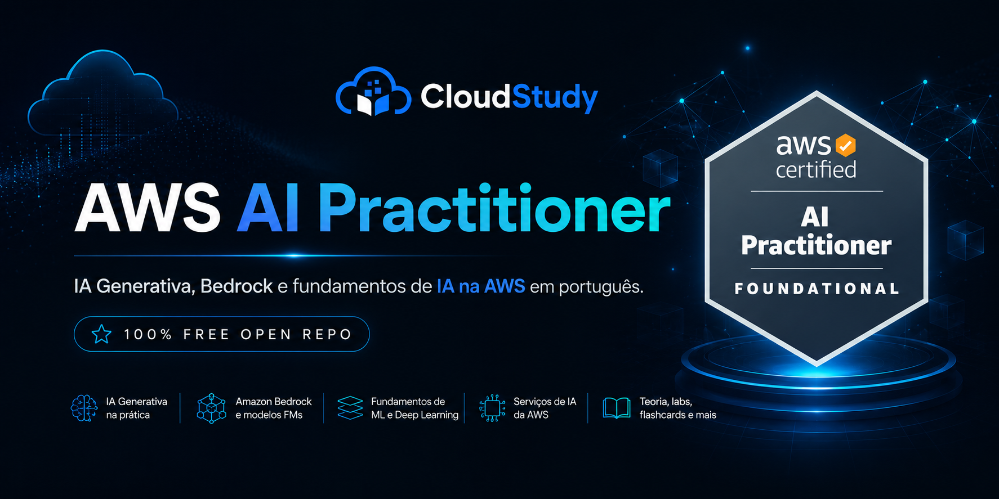
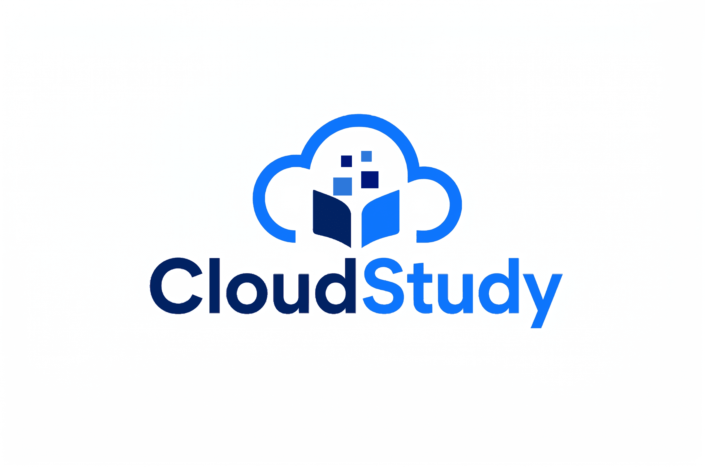

**English edition** · [Portuguese edition](https://github.com/Thiago-code-lab/aws-certified-ai-practitioner-brasil/tree/main) · [Edition audit](docs/english-edition/README.md)

<p align="center">
  
</p>

<p align="center">
  <a href="https://www.cloudstudy.com.br/">
    
  </a>
</p>

<p align="center">
  <strong>Study for the AWS AI Practitioner (AIF-C01) with foundations of Generative AI, Amazon Bedrock, Machine Learning, flashcards, and practice exams.</strong>
</p>

<p align="center">
  <strong>Join the CloudStudy waitlist and receive early access to the platform.</strong>
</p>

<p align="center">
  <a href="https://www.cloudstudy.com.br/">
    
  </a>
</p>

<div align="center">
  <a href="https://www.udemy.com/course/engenharia-de-dados-na-aws-do-zero-aos-projetos-reais/?referralCode=E28670B9116BA68E08A9">
    
  </a>
    
  <a href="https://chat.whatsapp.com/Lsuexbkt1oELAGX8nCH2La?mode=gi_t">
    
  </a>
</div>

<p align="center">
  
</p>

<div align="center">

<a href="https://www.cloudstudy.com.br/">
  
</a>

<a href="https://www.instagram.com/cloudstudy.ai/">
  
</a>

</div>

<h1 align="center">AWS Certified AI Practitioner (AIF-C01) | English Edition</h1>

<p align="center">
  Free, open-source study materials for AI fundamentals on AWS, with a progressive learning path.
</p>

<p align="center">
  
  
  
  
</p>

<p align="center">
  
  
  
</p>

<p align="center"></p>

## Overview

Prepare for **AWS Certified AI Practitioner (AIF-C01)** through 18 modules covering AI, machine learning, generative AI, and their business applications on AWS. Learn to choose services, evaluate model outputs, protect data, and apply responsible AI principles through detailed lessons, examples, flashcards, cheatsheets, guided labs, and practice questions.

These MIT-licensed learning materials are free. CloudStudy's platform and linked courses may have separate terms. Original project artwork is preserved and may contain Portuguese text.

## Recommended learning roadmap

1. **Modules 01–05:** AI and ML fundamentals, generative AI, foundation models, LLMs, embeddings, RAG, and Amazon Bedrock.
2. **Modules 06–10:** Amazon SageMaker AI, responsible AI, governance, data preparation, prompt engineering, and generative application design.
3. **Modules 11–15:** Security, compliance, use cases, AWS AI services, application integration, cost, latency, and quality optimization.
4. **Modules 16–18:** Practice exams, error analysis, final review, glossary, and official learning resources.

Read each lesson, answer its questions, and use the expandable flashcards for spaced repetition. Review the cheatsheet and complete the lab before moving on. Labs include conceptual architecture exercises and optional AWS exploration; read cost and cleanup instructions before provisioning resources.

## Modules and learning materials

| # | Module | Explanation | Active recall | Quick review | Practical work |
| --- | --- | --- | --- | --- | --- |
| 01 | Introduction to AI and ML | [Lesson](01-Introduction-to-AI-and-ML/README.md) | [Flashcards](01-Introduction-to-AI-and-ML/flashcards.md) | [Cheatsheet](01-Introduction-to-AI-and-ML/cheatsheet.md) | [Lab](01-Introduction-to-AI-and-ML/lab.md) |
| 02 | Generative AI Fundamentals | [Lesson](02-Generative-AI-Fundamentals/README.md) | [Flashcards](02-Generative-AI-Fundamentals/flashcards.md) | [Cheatsheet](02-Generative-AI-Fundamentals/cheatsheet.md) | [Lab](02-Generative-AI-Fundamentals/lab.md) |
| 03 | Machine Learning Fundamentals | [Lesson](03-Machine-Learning-Fundamentals/README.md) | [Flashcards](03-Machine-Learning-Fundamentals/flashcards.md) | [Cheatsheet](03-Machine-Learning-Fundamentals/cheatsheet.md) | [Lab](03-Machine-Learning-Fundamentals/lab.md) |
| 04 | Foundation Models and LLMs | [Lesson](04-Foundation-Models-and-LLMs/README.md) | [Flashcards](04-Foundation-Models-and-LLMs/flashcards.md) | [Cheatsheet](04-Foundation-Models-and-LLMs/cheatsheet.md) | [Lab](04-Foundation-Models-and-LLMs/lab.md) |
| 05 | Amazon Bedrock | [Lesson](05-Amazon-Bedrock/README.md) | [Flashcards](05-Amazon-Bedrock/flashcards.md) | [Cheatsheet](05-Amazon-Bedrock/cheatsheet.md) | [Lab](05-Amazon-Bedrock/lab.md) |
| 06 | Amazon SageMaker | [Lesson](06-Amazon-SageMaker/README.md) | [Flashcards](06-Amazon-SageMaker/flashcards.md) | [Cheatsheet](06-Amazon-SageMaker/cheatsheet.md) | [Lab](06-Amazon-SageMaker/lab.md) |
| 07 | Responsible AI and Governance | [Lesson](07-Responsible-AI-and-Governance/README.md) | [Flashcards](07-Responsible-AI-and-Governance/flashcards.md) | [Cheatsheet](07-Responsible-AI-and-Governance/cheatsheet.md) | [Lab](07-Responsible-AI-and-Governance/lab.md) |
| 08 | Data for AI | [Lesson](08-Data-for-AI/README.md) | [Flashcards](08-Data-for-AI/flashcards.md) | [Cheatsheet](08-Data-for-AI/cheatsheet.md) | [Lab](08-Data-for-AI/lab.md) |
| 09 | Prompt Engineering | [Lesson](09-Prompt-Engineering/README.md) | [Flashcards](09-Prompt-Engineering/flashcards.md) | [Cheatsheet](09-Prompt-Engineering/cheatsheet.md) | [Lab](09-Prompt-Engineering/lab.md) |
| 10 | Generative AI on AWS | [Lesson](10-Generative-AI-on-AWS/README.md) | [Flashcards](10-Generative-AI-on-AWS/flashcards.md) | [Cheatsheet](10-Generative-AI-on-AWS/cheatsheet.md) | [Lab](10-Generative-AI-on-AWS/lab.md) |
| 11 | AI Security and Compliance | [Lesson](11-AI-Security-and-Compliance/README.md) | [Flashcards](11-AI-Security-and-Compliance/flashcards.md) | [Cheatsheet](11-AI-Security-and-Compliance/cheatsheet.md) | [Lab](11-AI-Security-and-Compliance/lab.md) |
| 12 | AI Use Cases and Architectures | [Lesson](12-AI-Use-Cases-and-Architectures/README.md) | [Flashcards](12-AI-Use-Cases-and-Architectures/flashcards.md) | [Cheatsheet](12-AI-Use-Cases-and-Architectures/cheatsheet.md) | [Lab](12-AI-Use-Cases-and-Architectures/lab.md) |
| 13 | AWS AI Services | [Lesson](13-AWS-AI-Services/README.md) | [Flashcards](13-AWS-AI-Services/flashcards.md) | [Cheatsheet](13-AWS-AI-Services/cheatsheet.md) | [Lab](13-AWS-AI-Services/lab.md) |
| 14 | Application Integration | [Lesson](14-Application-Integration/README.md) | [Flashcards](14-Application-Integration/flashcards.md) | [Cheatsheet](14-Application-Integration/cheatsheet.md) | [Lab](14-Application-Integration/lab.md) |
| 15 | Best Practices and Optimization | [Lesson](15-Best-Practices-and-Optimization/README.md) | [Flashcards](15-Best-Practices-and-Optimization/flashcards.md) | [Cheatsheet](15-Best-Practices-and-Optimization/cheatsheet.md) | [Lab](15-Best-Practices-and-Optimization/lab.md) |
| 16 | Practice Exams and Questions | [Lesson](16-Practice-Exams-and-Questions/README.md) | [Flashcards](16-Practice-Exams-and-Questions/flashcards.md) | [Cheatsheet](16-Practice-Exams-and-Questions/cheatsheet.md) | [Practice exams](16-Practice-Exams-and-Questions/README.md) |
| 17 | Glossary | [Lesson](17-Glossary/README.md) | [Flashcards](17-Glossary/flashcards.md) | [Cheatsheet](17-Glossary/cheatsheet.md) | [Lab](17-Glossary/lab.md) |
| 18 | Resources and References | [Lesson](18-Resources-and-References/README.md) | [Flashcards](18-Resources-and-References/flashcards.md) | [Cheatsheet](18-Resources-and-References/cheatsheet.md) | [Lab](18-Resources-and-References/lab.md) |

## AWS AI and generative AI topics

- **AI and ML:** Supervised, unsupervised, and reinforcement learning; classification, regression, clustering, training, inference, evaluation, and generalization.
- **Generative AI:** Foundation models, LLMs, tokens, context windows, embeddings, vector databases, RAG, fine-tuning, prompting, and hallucination mitigation.
- **AWS services:** Amazon Bedrock, Amazon SageMaker AI, Amazon Q, Textract, Comprehend, Rekognition, Transcribe, Translate, Polly, Lex, and Personalize.
- **Responsible operation:** Fairness, explainability, human review, IAM, encryption, secrets, audit trails, privacy, monitoring, and cost control.

## Practice exams and final review

- [Question bank](16-Practice-Exams-and-Questions/questions.md): six multiple-choice questions with explanations.
- [Full Practice Exam 1](16-Practice-Exams-and-Questions/full-practice-exam-1.md): eight questions.
- [Full Practice Exam 2](16-Practice-Exams-and-Questions/full-practice-exam-2.md): eight questions, repeating the first set as in the source.
- [Domain practice](16-Practice-Exams-and-Questions/domain-practice-exams.md): eight questions; see the [domain inventory](docs/english-edition/question-audit.json) for classifications.
- [Final review](16-Practice-Exams-and-Questions/final-review-aif-c01.md): 14-day and 7-day plans.
- [Error log](16-Practice-Exams-and-Questions/error-log.md), [exam cheatsheet](16-Practice-Exams-and-Questions/cheatsheet.md), and [glossary](17-Glossary/README.md).

The source contains **30 multiple-choice occurrences (22 distinct questions)**, **85 short-answer review prompts**, and **144 flashcards**. Despite the inherited “Full Practice Exam” filenames, the two eight-question sets are short exercises. They do not constitute a full-length 65-question mock exam. No questions have been added or removed.

## Official AWS references

The 18 modules form a learning sequence; the certification has five official domains. Consult the [AWS exam guide](https://docs.aws.amazon.com/aws-certification/latest/ai-practitioner-01/ai-practitioner-01.html), [in-scope services](https://docs.aws.amazon.com/aws-certification/latest/ai-practitioner-01/aif-01-in-scope-services.html), and [certification page](https://aws.amazon.com/certification/certified-ai-practitioner/) before scheduling the exam.

| Official domain | Weight |
| --- | ---: |
| 1. Fundamentals of AI and ML | 20% |
| 2. Fundamentals of GenAI | 24% |
| 3. Applications of Foundation Models | 28% |
| 4. Guidelines for Responsible AI | 14% |
| 5. Security, Compliance, and Governance for AI Solutions | 14% |

References were checked on November 16, 2026. The [revision history](https://docs.aws.amazon.com/aws-certification/latest/ai-practitioner-01/aif-01-revisions.html) lists exam guide version 1.2, published October 29, 2026. This edition translates the complete source curriculum; consult the current guide for newer agentic AI topics and service changes beyond that source scope. Start hands-on learning with [AWS Skill Builder](https://skillbuilder.aws/), and consult [Bedrock documentation](https://docs.aws.amazon.com/bedrock/latest/userguide/what-is-bedrock.html) and [SageMaker AI documentation](https://docs.aws.amazon.com/sagemaker/latest/dg/whatis.html) for service details.

## Related English learning paths

- [AWS Certified Cloud Practitioner (CLF-C02)](https://github.com/Thiago-code-lab/aws-certified-cloud-practitioner-brasil/tree/clf-c02-english).
- [AWS Certified Solutions Architect – Associate (SAA-C03)](https://github.com/Thiago-code-lab/aws-certified-solutions-architect-associate-brasil/tree/saa-c03-english).

Amazon Q Business and Amazon Bedrock Agents Classic are closed to new customers. Their source use cases remain with availability notes in the lessons; see the [technical review](docs/english-edition/README.md) before choosing services for a new project.

## Read offline

```sh
git clone --branch aif-c01-english https://github.com/Thiago-code-lab/aws-certified-ai-practitioner-brasil.git
cd aws-certified-ai-practitioner-brasil
```

Open the Markdown files in your editor or browse this branch on GitHub. No application installation is required.

## Contributions and license

Submit English documentation improvements against `aif-c01-english`. Use the [bug report](.github/ISSUE_TEMPLATE/bug_report.md), [AWS update](.github/ISSUE_TEMPLATE/aws_update.md), or [teaching suggestion](.github/ISSUE_TEMPLATE/pedagogy_suggestion.md) template. Include an official AWS source when proposing technical or answer-key changes. See the [audit](docs/english-edition/README.md) for reproducible validation.

Available under the [MIT License](LICENSE). These independent study materials are not official AWS exam questions and do not guarantee certification success.

## ☁️ Follow CloudStudy

CloudStudy is building a platform to make AWS study more practical, organized, and accessible. Follow new materials and certification updates:

- [CloudStudy](https://www.cloudstudy.com.br/)
- [Instagram](https://www.instagram.com/cloudstudy.ai/)
- [LinkedIn](https://www.linkedin.com/company/cloudstudy-ai/)
